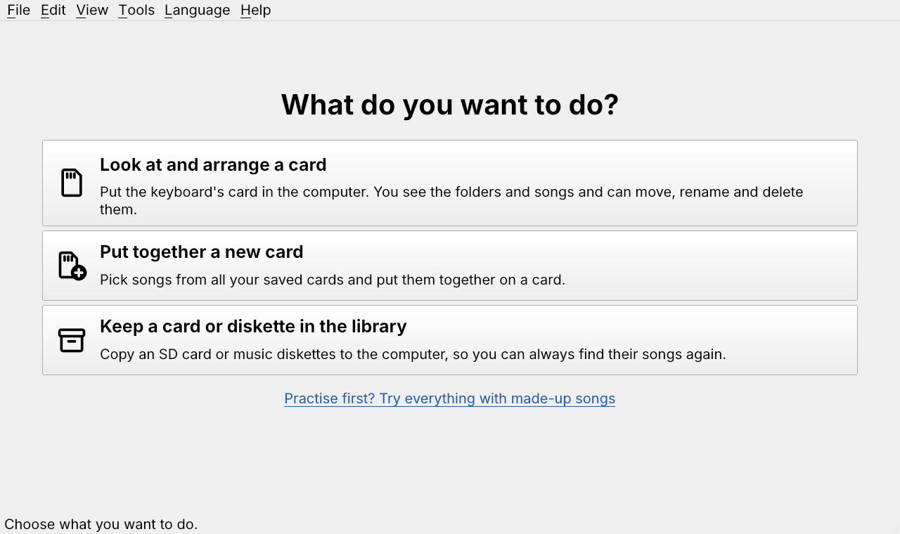
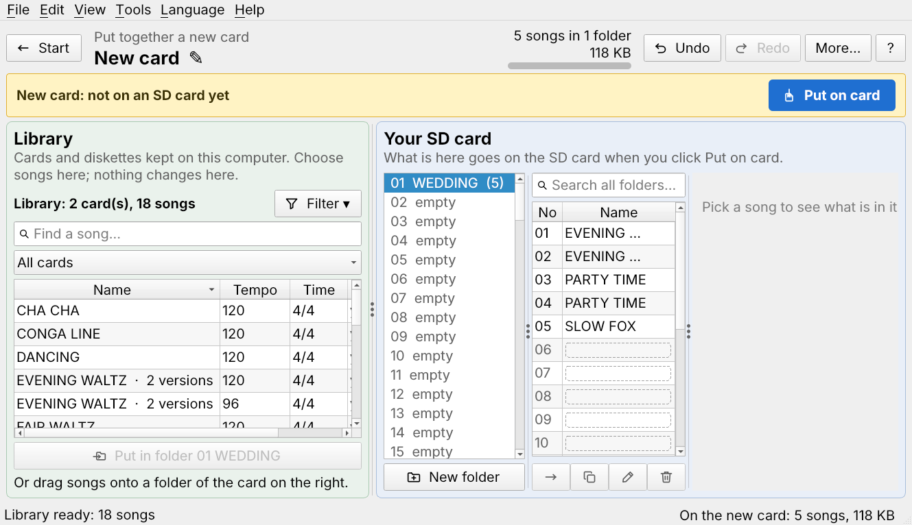
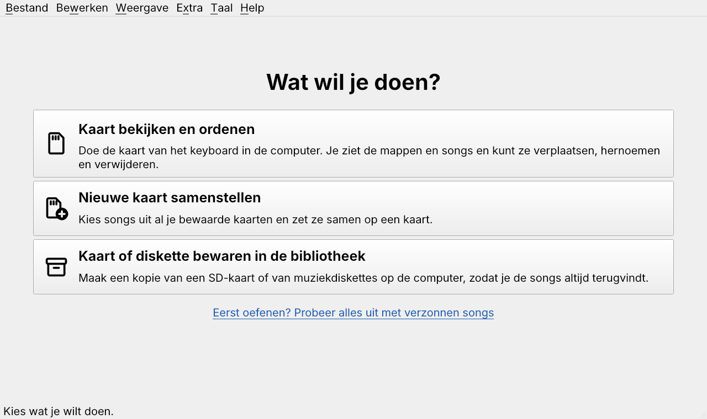
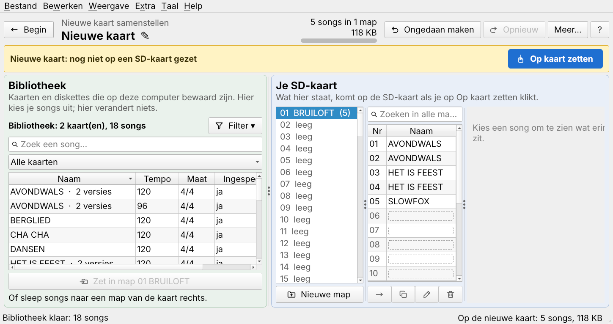

# KN Songboek

[](LICENSE)


**Your Technics SX-KN7000 songs, finally on a big screen.**
See every folder and song on your SD card at a glance, tidy them up with drag and drop, keep all your cards and
music diskettes safe on the computer, and build a new card for tonight's gig in minutes.

**[English](#english)** · **[Nederlands](#nederlands)** · **[Testers wanted](#testers-wanted-)**

| Start: three big buttons | Build a new card from your library |
|:---:|:---:|
|  |  |

*All screenshots use made-up songs.*

---

## English

### Why KN Songboek?

On the keyboard you see one folder at a time, on a small screen. KN Songboek shows the whole card: 99 folders,
every song, and per song the tempo, time signature, rhythm and what is on each panel button. Made for musicians,
not for computer people: three big buttons to start, nothing changes on your card until you say so, and there
is always a backup.

### What you can do

- **Tidy up a card.** Drag songs and folders to another place, copy, rename (16 characters, like the keyboard)
  and remove them, also several at once. Edit the keyboard's favourites and song lists.
- **Keep everything safe.** Put each SD card and music diskette in your library on the computer. The app checks
  the copy file by file.
- **Build a new card.** Pick songs from all your cards and diskettes, with search and filters (tempo, time
  signature, "not on my card yet", damaged, …).
- **Look inside a song.** Tempo, time signature, rhythm and the registrations per button. Anything the app is
  not sure about is shown in orange; no information is ever lost.
- **Print your song list.** A clear PDF or a CSV for a spreadsheet, of one card or your whole library, with the
  columns you choose.
- **Diskettes too.** Reads KN7000 and KN6000 music diskettes, including the songs inside diskette sets.
- **Dutch and English**, with a manual in both languages.

### Get started in 3 steps

1. **Download** the latest version from [Releases](../../releases):
   - **macOS**: `…-macOS-AppleSilicon.zip` for a Mac with an Apple chip (M1 or newer), `…-macOS-Intel.zip`
     for an older Mac (Apple menu › *About This Mac* tells you which). Unzip it and drag *KN Songboek* to
     *Applications*. The first time macOS will not open it (the app is not registered with Apple): try once,
     then go to *System Settings › Privacy & Security* and click *Open Anyway*.
   - **Windows**: `…-Windows.exe`. If you see "Windows protected your PC", click *More info* and then
     *Run anyway*.
2. **Put your SD card in the computer** (or a diskette in a USB floppy drive).
3. **Start the app and pick a task**: *Look at and arrange a card*, *Put together a new card*, or *Keep a card or
   diskette in the library*. The **?** button opens the part of the [manual](docs/en/manual.md) for that screen.

### Safe by design

- **Prepare first, then save.** Everything can be undone until you click *Put on card*.
- **Always a backup.** Before the app writes to a card it makes a backup on the computer, which you can bring
  back under *More… › Back-ups*.
- **Checked after writing.** The app reads the card back and reports any difference.
- **No internet.** The app sends nothing anywhere and collects nothing.

### Status

Version 0.2, in development. Reading has been tested on real cards and diskettes. Cards written by the app
still need more testing on the keyboard itself, so keep a copy of any card you cannot lose (the app also makes
a backup automatically). Plans are in [ROADMAP.md](ROADMAP.md), changes in [CHANGELOG.md](CHANGELOG.md).

### Testers wanted 🎹

Do you play a KN7000 (or have KN6000 diskettes)? Your help makes the app safe for everyone. Most wanted: put a
card made with the app in your keyboard and check that the songs, favourites and song lists work as expected.
Diskettes and older cards with unusual contents are very welcome too.

Tell us what you tried and what happened in [Issues](../../issues), with a screenshot if you can. Please do
not upload card or diskette files: a description is enough, and your songs stay yours.

### For developers

Run from source with Python 3.9 or newer:

```bash
uv sync --extra gui && uv run kn-songboek        # or: pip install ".[gui]" && kn-songboek
```

There is also a command line, `kn-songboek-cli` (`ls`, `check`, `move --dry-run`, …). How to build, the checks
and the rules of this repository (such as: never card contents in git) are in [CONTRIBUTING.md](CONTRIBUTING.md).
The developer documentation is in Dutch: [docs/nl](docs/nl/README.md).

---

## Nederlands

| Beginnen: drie grote knoppen | Een nieuwe kaart uit je bibliotheek |
|:---:|:---:|
|  |  |

### Waarom KN Songboek?

Op het keyboard zie je één map tegelijk, op een klein scherm. KN Songboek laat de hele kaart zien: 99 mappen,
alle songs, en per song het tempo, de maat, het ritme en wat er op elke paneelknop staat. Gemaakt voor
muzikanten, niet voor computermensen: drie grote knoppen om te beginnen, er verandert niets op je kaart tot jij
dat zegt, en er is altijd een back-up.

### Wat kun je ermee?

- **Een kaart netjes maken.** Sleep songs en mappen naar een andere plek, kopieer, hernoem (16 tekens, net als
  op het keyboard) en haal ze weg, ook meer tegelijk. Pas de favorieten en songlijsten van het keyboard aan.
- **Alles veilig bewaren.** Zet elke SD-kaart en muziekdiskette in je bibliotheek op de computer. De app
  controleert de kopie bestand voor bestand.
- **Een nieuwe kaart samenstellen.** Kies songs uit al je kaarten en diskettes, met zoeken en filters (tempo,
  maat, "nog niet op mijn kaart", beschadigd, …).
- **Zien wat er in een song zit.** Tempo, maat, ritme en de registraties per knop. Waar de app niet zeker van
  is, staat in het oranje: er gaat geen informatie verloren.
- **Je songlijst afdrukken.** Een duidelijke PDF of een CSV voor een spreadsheet, van één kaart of je hele
  bibliotheek, met de kolommen die jij kiest.
- **Ook diskettes.** Leest muziekdiskettes van de KN7000 en de KN6000, ook de songs in diskette-sets.
- **Nederlands en Engels**, met een handleiding in beide talen.

### Beginnen in 3 stappen

1. **Download** de nieuwste versie bij [Releases](../../releases):
   - **macOS**: `…-macOS-AppleSilicon.zip` voor een Mac met Apple-chip (M1 of nieuwer), `…-macOS-Intel.zip`
     voor een oudere Mac (Apple-menu › *Over deze Mac* laat zien welke je hebt). Pak de zip uit en sleep
     *KN Songboek* naar *Programma's*. De eerste keer opent macOS hem niet (de app is niet bij Apple
     aangemeld): probeer het één keer, ga dan naar *Systeeminstellingen › Privacy en beveiliging* en klik op
     *Open toch*.
   - **Windows**: `…-Windows.exe`. Zie je "Windows heeft uw pc beschermd"? Klik dan op *Meer informatie* en
     daarna op *Toch uitvoeren*.
2. **Doe je SD-kaart in de computer** (of een diskette in een USB-diskettestation).
3. **Start de app en kies een taak**: *Kaart bekijken en ordenen*, *Nieuwe kaart samenstellen* of *Kaart of
   diskette bewaren in de bibliotheek*. De knop **?** opent het stuk van de [handleiding](docs/nl/handleiding.md)
   dat bij het scherm hoort.

### Veilig gebouwd

- **Eerst klaarzetten, dan opslaan.** Alles kun je ongedaan maken, tot je op *Op kaart zetten* klikt.
- **Altijd een back-up.** Voordat de app iets op een kaart schrijft, maakt hij een back-up op de computer. Die
  zet je terug via *Meer… › Back-ups*.
- **Controle na het schrijven.** De app leest de kaart daarna terug en meldt elk verschil.
- **Geen internet.** De app stuurt niets weg en verzamelt niets.

### Status

Versie 0.2, in ontwikkeling. Het lezen is getest op echte kaarten en diskettes. Kaarten die de app maakt, moeten
nog meer getest worden op het keyboard zelf. Bewaar daarom een kopie van een kaart die je niet kwijt wilt (de
app maakt ook zelf een back-up). Plannen staan in [ROADMAP.md](ROADMAP.md), wijzigingen in
[CHANGELOG.md](CHANGELOG.md).

### Testers gezocht 🎹

Speel je op een KN7000 (of heb je KN6000-diskettes)? Met jouw hulp wordt de app veilig voor iedereen. Het
meest gezocht: zet een kaart die met de app gemaakt is in je keyboard en kijk of de songs, favorieten en
songlijsten doen wat je verwacht. Diskettes en oudere kaarten met bijzondere inhoud zijn ook heel welkom.

Vertel wat je probeerde en wat er gebeurde bij [Issues](../../issues), met een schermafbeelding als dat lukt.
Stuur liever geen kaart- of diskettebestanden mee: een beschrijving is genoeg, en je songs blijven van jou.

### Voor ontwikkelaars

Starten vanuit de broncode, met Python 3.9 of nieuwer:

```bash
uv sync --extra gui && uv run kn-songboek        # of: pip install ".[gui]" && kn-songboek
```

Er is ook een opdrachtregel, `kn-songboek-cli` (`ls`, `check`, `move --dry-run`, …; zie
[docs/nl/reference/cli.md](docs/nl/reference/cli.md)). Bouwen, de controles en de regels van deze repository
(zoals: nooit kaartinhoud in git) staan in [CONTRIBUTING.md](CONTRIBUTING.md). De opbouw van de code staat in
[docs/nl/explanation/architectuur.md](docs/nl/explanation/architectuur.md). Het kaartformaat is niet door de
fabrikant gepubliceerd; het is uitgezocht uit het gedrag van het keyboard en gecontroleerd op echte kaarten.
Alle code is zelf geschreven ([ADR-0004](docs/nl/decisions/0004-licentie-en-bronnen.md)).

---

## License · Licentie

[MIT](LICENSE): free to use, change and share. Technics and SX-KN7000 are trademarks of their owner. KN Songboek
is an independent project, not connected to the maker of the keyboard.

Vrij te gebruiken, aan te passen en te delen. Technics en SX-KN7000 zijn merken van hun eigenaar. KN Songboek is
een onafhankelijk project zonder band met de fabrikant van het keyboard.
