# KN Songboek manual

KN Songboek is a program for the computer. You use it to tidy up the songs on the SD card of your Technics KN7000.
You can move songs, copy them, give them another name and remove them. You can keep your cards and music
diskettes on the computer. And you can make a new card from all your songs. After that, the card simply works
in the keyboard again.

You don't need to know anything about computers. Just read the part about what you want to do.

**The most important things to remember**

- Nothing changes on the card until you click **Put on card**. Until then you can try things out calmly.
- Made a mistake? Click **Undo**. You can do that as often as you like.
- Before the program puts anything on a card, it first keeps a spare copy (a *back-up*) on the computer. So you
  never lose anything.

*The pictures in this manual were made with made-up songs, in the Dutch version of the program.*

<!-- bestand -->
*This manual is written for the Mac. Using Windows? Then read **Ctrl** where it says **Cmd**, **Alt** where it
says **Option**, **File Explorer** where it says **Finder** and **Recycle Bin** where it says **Trash**. The
shortcuts have a table for both. In the program itself (the **?** button) you see the manual with the keys of
your own computer straight away.*
<!-- /bestand -->

## Contents

1. [Getting started](#1-getting-started)
2. [Looking at and arranging a card](#2-looking-at-and-arranging-a-card)
3. [Working with songs](#3-working-with-songs)
4. [Arranging folders](#4-arranging-folders)
5. [Put on card, and undo](#5-put-on-card-and-undo)
6. [Keeping a card or diskette in the library](#6-keeping-a-card-or-diskette-in-the-library)
7. [Putting together a new card](#7-putting-together-a-new-card)
8. [More…: favourites, song lists and what is in a song](#8-more-favourites-song-lists-and-what-is-in-a-song)
9. [Something went wrong? Restoring a back-up](#9-something-went-wrong-restoring-a-back-up)
10. [Good to know](#10-good-to-know)

**A few words that come up often**

| Word | What it is |
|------|------------|
| **SD card** (or *card*) | The small memory card from the keyboard. Your songs are on it. |
| **Folder** | A card has 99 folders, and each folder holds 20 songs. Just like on the keyboard. |
| **Library** | A folder on the computer with a copy of your cards and diskettes. You pick songs from it for a new card. |
| **Back-up** | A spare copy the program makes by itself, so you can always go back. |

## 1. Getting started

Start KN Songboek. The program asks **What do you want to do?** You see three big buttons:

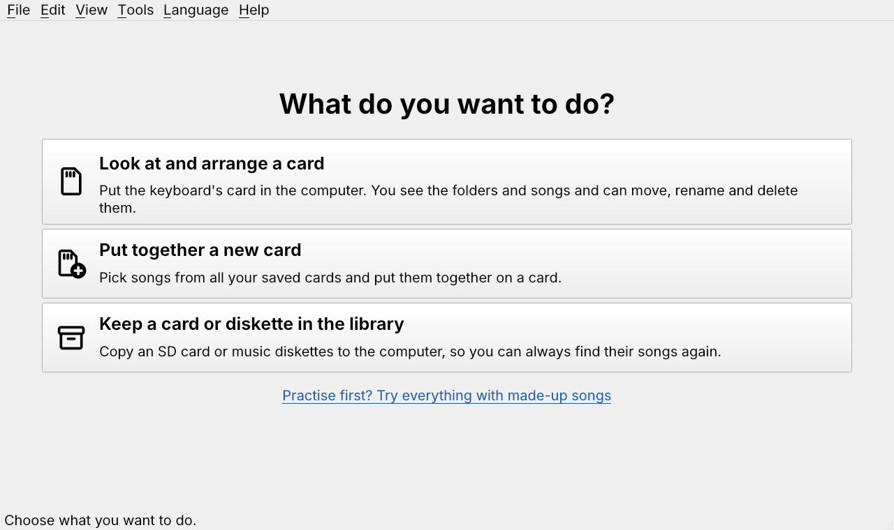

- **Look at and arrange a card**: see what is on the keyboard's card and tidy it up.
  See [chapter 2](#2-looking-at-and-arranging-a-card).
- **Put together a new card**: bring songs from all your kept cards together on one card.
  See [chapter 7](#7-putting-together-a-new-card).
- **Keep a card or diskette in the library**: put a copy of a card or a music diskette on the computer. Then
  you can always find those songs again. See [chapter 6](#6-keeping-a-card-or-diskette-in-the-library).

Each task has a colour of its own: blue, green and orange. Under the buttons you see how many cards and diskettes
are already in your library.

At the top left there is always the **Start** button. It takes you back to this screen. At the top right there
is a **?**. Click it when you are not sure how something works: you then see the part of this manual about that
screen.

The first time, there is a blue tip at the top. Click **Got it** to make it go away.

### Practise first

Do you want to try out calmly how everything works first? Below the three buttons, click **Practise first? Try
everything with made-up songs**.

- You then work with made-up songs. There is already a practice card in the computer, and there is already a
  kept card in the library.
- The three buttons work exactly as they do for real.
- You put a card in the computer with the **Swap card…** button in the orange bar at the top. There you choose
  the practice card, a new empty card, or no card.
- Your real cards and your real library stay as they are.

Done practising? Click **Stop practising**. Next time, practising starts completely afresh.

## 2. Looking at and arranging a card

1. Take the SD card out of the keyboard and put it in the computer (or in a card reader).
2. Click **Look at and arrange a card**. The program finds the card by itself.

Are there two cards in the computer? Then the program asks which one you mean. Can it not find a card? Then it
says so, and it also says what is in the computer instead. Put the card in and click **Look again**.

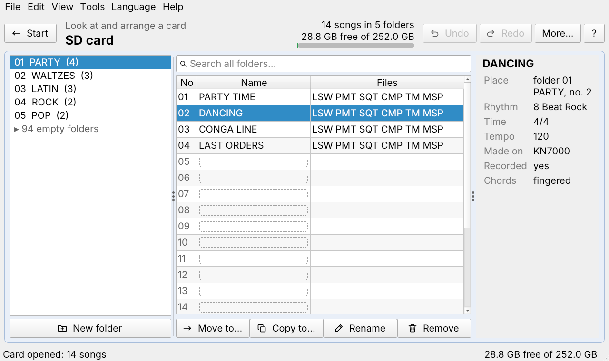

This is what you then see:

- **At the top**: the name of the card, how many songs and folders are on it, and a bar that shows how full the
  card is.
- **On the left**: the folders that have songs in them, with the number of songs after them. The empty folders
  are together behind one line, for example "▸ 94 empty folders". Click it to see them.
- **In the middle**: the 20 places of the folder you chose on the left, just like on the keyboard. An empty
  place is a lightly dotted box.
- **Above the songs**: a search box. Type part of a name, and you see that song in all folders.
- **On the right**: information about the song you clicked, if that panel is switched on. See below.

### Song information (on the right)

On the right there can be a panel with information about the song you clicked. You switch that panel on or off
yourself: in the menu bar choose **View › Song information** (or press **Cmd+I**). The program remembers your
choice. If the panel is off, you see nothing on the right, and you have more room for the folders and songs.

If the panel is on, click a song. At the top of the panel you see the most important things: in which place the
song is, the rhythm, the time signature, the tempo, whether something has been recorded, and in which
favourites or song lists it is.

Below that is everything else that is in the song, under headings. Click a heading (▾ or ▸) to fold it open or
shut.

Under **Registrations** you see the panel's buttons (the Reg Banks). You can choose how you see them:

- **Buttons**: choose a bank (A, B or C) and you see the 8 buttons, just like on the keyboard. Click a button and
  you see the rhythm, the tempo, the chords and the sounds. A grey letter is an empty bank.
- **List**: all banks below each other. That is handy for comparing banks. Click ▸ next to a button to see its
  settings.

Do you want to see everything the program can read from the song? Then choose **View › Detailed information** in
the menu bar. Values whose meaning is not certain yet are shown in orange.

## 3. Working with songs

Click a song to choose it. Do you want to choose several songs at once? Then hold **Shift** or **Cmd** while you
click.

Below the songs there are four buttons:

- **Move to…**: the song goes to another folder. You choose the folder from a table that shows, per folder,
  the number, the name, how many songs are in it and how many places are still free. A full folder is greyed out
  ("full") and cannot be chosen. At the bottom is **+ New folder…**.
- **Copy to…**: the song is added to another folder. The original stays where it is.
- **Rename**: give the song another name.
- **Remove**: take the song off the card.

You get the same choices when you click a song with the right mouse button.

**Removing whole folders**: choose one or more folders in the folder list (Cmd-click or Shift-click) and press
Delete, or click with the right mouse button and choose **Remove folder(s)…**. After one question the songs go and
the folders are empty again. **Undo** brings them back as long as you have not saved.

A name can be 16 characters long. Don't use letters with accents (such as é or ü), because the keyboard cannot
show them.

### Rather drag?

| What do you want? | This is how |
|-------------------|-------------|
| Copy a song to another folder | Drag the song to a folder in the list on the left. You then see a "+". |
| Move a song to another folder | Drag the song, and hold **Option** while dragging. |
| Change the order in a folder | Drag the song to another place in the same folder. The two songs swap places. |
| Put a few songs together | Choose the songs and drag them to a place in the same folder. They end up there one after the other; the other songs shift along. |
| Give another name | Double-click the name. |

While dragging you also see the empty folders. The folder under the mouse lights up, and at the bottom of the
screen it says what is going to happen.

After every change a small bar appears at the bottom for a moment, for example "1 song moved to folder 3". Next
to it is **Undo**, in case that was not what you meant.

Is a song also in a favourite or a song list? Then that simply moves along when you move the song.

Did you give a song another name? Then the name is yellow, with the old name behind it, for example
"HET IS FEEST (was: FEEST)". Click the song and the old name is also shown on the right. **Put the old name
back** gives only that song its old name back. Once everything is on the card, the yellow is gone again.

## 4. Arranging folders

You can drag a whole folder to another place in the list.

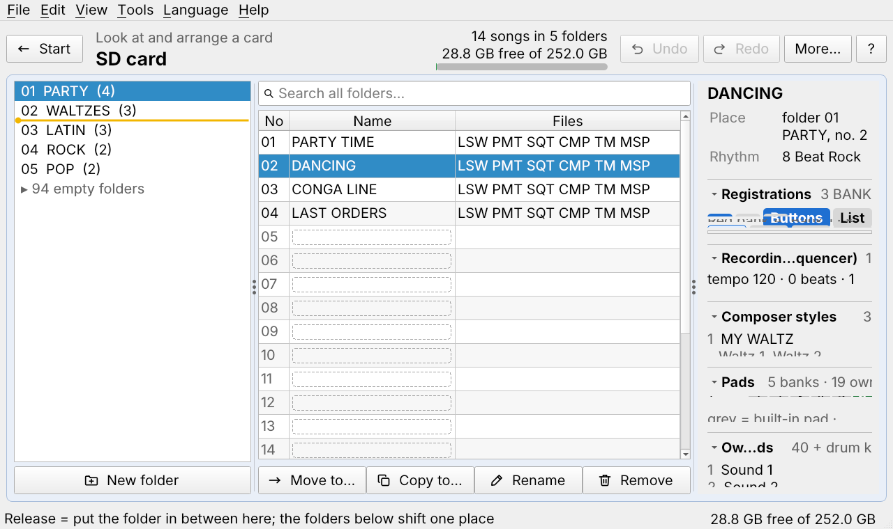

- If you drag the folder **between two other folders**, you see a yellow line. When you let go of the mouse,
  the folder goes there. The folders below it shift one place down.
- If you drag the folder **onto an empty folder**, you see a yellow frame. The folder moves to that place, with
  its name and all its songs.

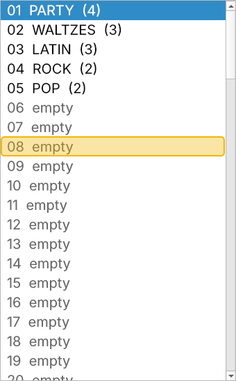

Move several folders at once? Hold **Cmd** and click the folders you want (or click the first and hold
**Shift** on the last). Then drag them together between two other folders. They end up there one after the
other, in their own order. The other folders shift along.

Give a folder another name? Double-click the folder.

Make a new folder? Click **New folder** below the list. The first empty folder then gets the name you type.

## 5. Put on card, and undo

Everything you change is at first only in the program. Nothing has changed on the card yet. You see a
**yellow bar** at the top as long as there is something that is not on the card yet.

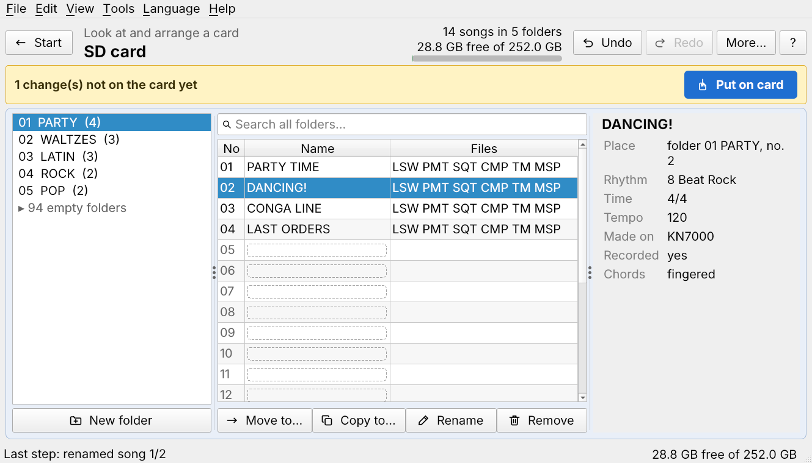

- **Undo** (button at the top): take back the last change. You can do that as often as you like.
- **Redo** (button next to it): do a change you undid after all.
- **Put on card** (button in the yellow bar): put all changes on the card.

### What happens with Put on card?

A window opens. At the top you see the steps, each with a circle and a number. The blue circle is the step you
are at now. A step that is finished gets a green tick. Below them it says, for example, **Step 2 of 3**.

The program:

1. checks whether there is enough room on the card, and whether the card may be written to;
2. makes a back-up of the card on the computer;
3. puts the changes on the card;
4. reads everything back and checks that it is right.

You see this list in the window. What is finished gets a green tick. What the program is doing now is in bold.
Under the bar it says **Do not take the card out yet.** Only take the card out when you see **Done**.

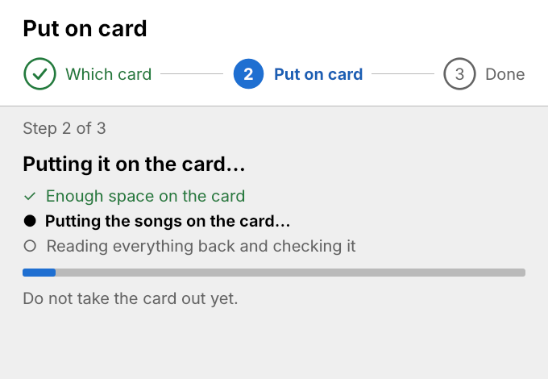

Then you see a big tick and **Done**. The program ejects the card properly. You can now take it out and put it
back in the keyboard.

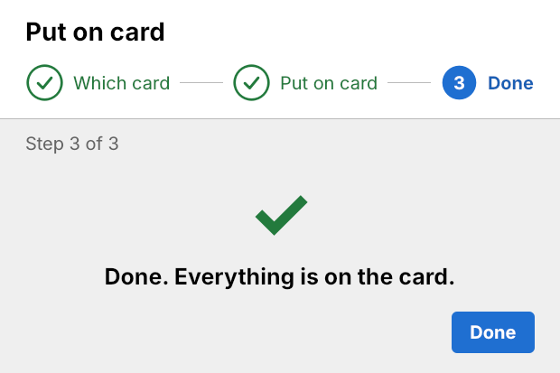

If you click **Start**, or close the program while there are still changes, the program asks whether you want to
put them on the card first, or throw them away.

### Did the program stop unexpectedly?

Did the program stop while there were changes that are not on the card yet? For example because of a fault,
or because the computer restarted? Then your changes are not lost. The program keeps them on the computer
(not on the card) after every change.

The next time you start the program, it asks whether you want to **carry on where you left off**.

- **Yes, carry on**: your changes are ready again, with the yellow bar. Undo works again too. Was it an SD
  card? Then put the same card in the computer. The program asks for it if it is not in yet.
- **No, throw away**: the changes are then gone for good. The card stays as it was.
- **Decide later**: nothing changes. The next time it starts, the program asks again.

Was the card changed in the meantime, or is another card in? Then the program says the changes no longer fit
it. You can put the right card in, or throw the changes away.

### If something is not right

If something goes wrong, a message says in plain words what happened and what you can do. At the bottom there
are small grey lines with technical details. Those are for when you ask someone for help.

- **Was the card taken out of the computer too early last time?** Then the program says so when you open the
  card. You can then put everything back as it was.
- **Is the card missing song files?** Then the program offers to rebuild the list of songs on the card.
- **Are there loose files on the card that belong to no song at all?** Then the program asks what you want.
  With **Clean up** they are removed the next time you Put on card. With **Leave them** nothing changes.

## 6. Keeping a card or diskette in the library

The library is a folder on the computer. It holds a copy of every card and diskette you keep. You use the
library to look up songs and to put new cards together from. Your cards themselves do not change because of it.

### Keeping an SD card

1. Put the card in the computer.
2. Click **Keep a card or diskette in the library**. A window opens with the steps at the top. Is the card not
   in yet? Then put it in; the program carries on by itself.
3. The first time, the program asks where the library should go. It suggests a place itself
   (*Documents/KN7000 Bibliotheek*). Click **Yes, there**, unless you want another place. The program
   remembers this.
4. Type what is on the **label** of the card, for example "Wedding card". That is the card's name in the
   library, so you recognise it straight away later.

Do you keep the same card again later? Then the program recognises it. It asks whether you want to replace the
old copy on the computer with what is on the card now. That way the library stays up to date. The old copy is
kept as a back-up first.

### Everything is checked

While keeping, the program checks every file three times. At the end you see every check with a ✓:

- **Read**: every file was read twice, and was the same both times. That way a bad spot on an old diskette is
  noticed.
- **Unpacked**: every song was unpacked completely, without errors.
- **Read back**: what is in the library was read back and compared with the original.

If something goes wrong, you get a message with the name of the song. In the library that song is then shown in
orange, with a ⚠ after its name. If you still want to put it on a card, the program first asks whether you are
sure.

### Keeping music diskettes

You keep KN7000 and KN6000 diskettes with the same button. You need a floppy drive (a USB floppy drive works
fine).

1. Put the diskette in the floppy drive.
2. Click **Keep a card or diskette in the library**. Is there also an SD card in? Then the program asks which
   one you mean.
3. Type what is on the **label** of the diskette.
4. The program reads the diskette. That takes about half a minute. The diskette itself does not change.
5. The diskette comes out, and you see **✓ Diskette 1 is in the library**. Put the next diskette in straight
   away: the program carries on by itself. That way you work through a whole pile.
6. No more diskettes? Click **Done**.

Do you put in a diskette that is already in the library? Then the program recognises it and you can skip it.

In the library the diskettes are together under **Diskettes**. Each set on a diskette is one song there. You can
put it on a new card just like other songs.

### Keeping a download from the internet

Did you download songs as a zip file? Double-click the zip file to unpack it. Then click **Keep a card or
diskette in the library**, then **Choose a folder…**, and choose the unpacked folder. The program treats that
folder as a diskette.

Note: many downloads are for the KN5000. The program cannot read those. Under **Made on** it then says *KN5000*.

### Renaming or removing a card in the library

Go to **Put together a new card** and choose the card at the top left. Below it are two buttons:

- **Rename card…**: give the card in the library another name.
- **Remove card…**: take the card out of the library. It goes to the Trash, so you can still get it back from
  there. The real card or diskette does not change.

## 7. Putting together a new card

Click **Put together a new card**. Have you kept cards already? Then the program first asks **How do you want to
start?**

- **Start empty**: you start with an empty card.
- **Start from** a kept card: everything from that card is already on it (folders, songs, song lists and
  favourites). You only change what needs to be different.

The screen has two sides:

- **On the left, in a green area: the Library.** All songs of all your kept cards and diskettes are here. You
  pick songs here. Nothing changes in the library itself.
- **On the right, in a blue area: Your SD card.** This is the new card. What is here goes onto the SD card when
  you click **Put on card**.

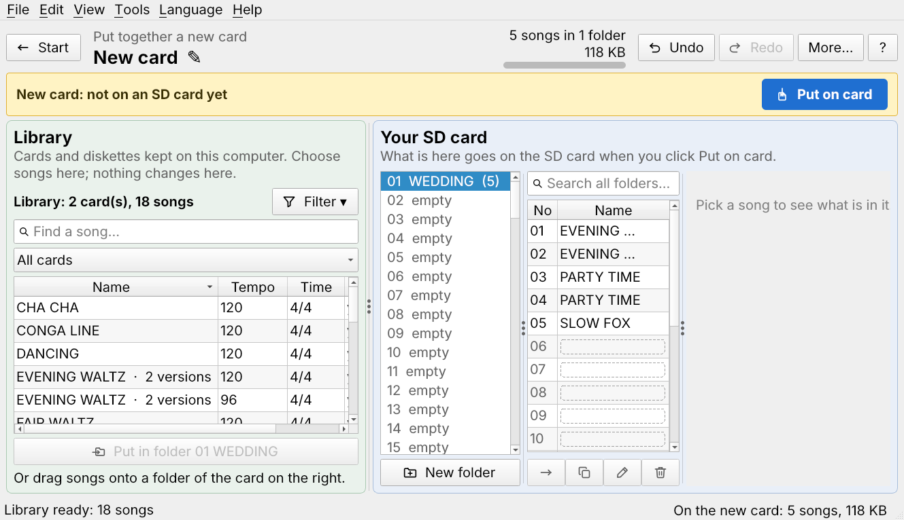

### Picking songs from the library

- **Search**: type part of the name in the search box.
- **Filter**: click **Filter** to see more choices. When a filter is on, the button shows it, for example
  *Filter (2)*.
  - **Not on my card yet**: hides the songs that are already on your new card on the right. Also when you gave
    them another name there.
  - **Recorded only**: only songs that have something recorded.
  - **Only damaged (⚠)**: only the orange songs.
  - **Tempo** and **Time**: for example only waltzes (3/4), or only songs between 90 and 120.
  - **Only from SD cards** or **Only from diskettes**.
  - **On one card only** or **On more than one card**: that way you see which songs you have only once.
- **On card**: this column says on which card and in which folder a song is. That way you can also pick up the
  real card.
- **"· 2 versions"** after a name: there are two songs with the same name, but they are not quite the same.

**Putting a song on your card:** first click the folder on the right where it should go. Then choose the song on
the left and click **Put in folder …**. Double-clicking or dragging to a folder on the right works too.

### Looking at one kept card

Choose a card in the choice box at the top of the library. You then see that card's folders, just like on the
keyboard. Click a folder to see the songs, with their number in the folder.

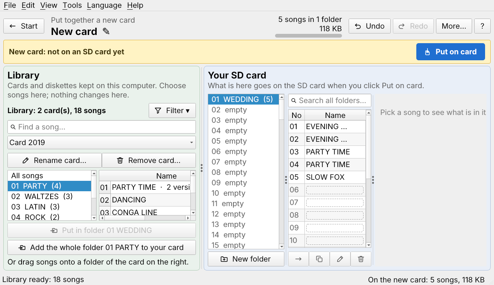

Do you want to take over a whole folder in one go? Click the folder and then **Add the whole folder … to your
card**. That works for a song list too.

Take over several folders at once? Hold **Cmd** and click the folders. The button then says
**Add 2 whole folders to your card** (or 3, 4 …). You can also drag the folders together to the list on the
right. If you let go on an empty folder, they start there. Each folder goes into an empty folder of its own,
with its name and all its songs.

The **favourites** of those songs come along: on the same button number, in the same favourite bank if
possible. Is that bank on your card already yours (another name, or the button is taken)? Then they go into an
empty bank, with the old bank's name. Your own favourites are never overwritten. If there is no empty bank
left, the program says how many favourites could not come along. The songs themselves are on your card.

Have you not kept any cards yet? Then on the left there is only a button **Keep a card or diskette in the
library**.

### Done? Put on card

Click **Put on card**. A window opens with the steps **Which card → Put on card → Done**.

1. Put an SD card in the computer. That can be an empty card, or the keyboard's card.
2. Are there more cards in? Then click the big button of the card you want to use.
3. Are there songs on that card already? Then the program warns you first. Those songs are replaced, but the
   program keeps them in a back-up first.

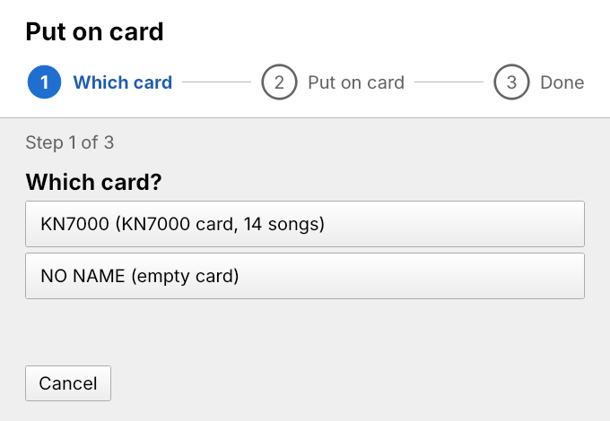

Then the program asks whether you want to **keep the new card in the library too**. Do that if you want to make
another card from it later. Do you want to make another card with the same songs straight away? Then click
**Another card with the same songs**.

### No SD card at hand?

You can also keep a new card on the computer first, and put it on an SD card later:

1. Click **Put on card**. The program says there is no SD card in the computer.
2. Click **Keep in the library…** and give the card a name.
3. Later, put an SD card in the computer. Click **Put together a new card**, choose **Start from** and the name of
   your card, and click **Put on card**.

## 8. More…: favourites, song lists and what is in a song

At the top right is the **More…** button. It holds what you don't need every day, with big buttons in three
groups: Playing, Card and Help.

Everything is also in the menu bar, at the top of the screen. There are also things you hardly ever need, such
as opening a card by hand, choosing the library and the language.

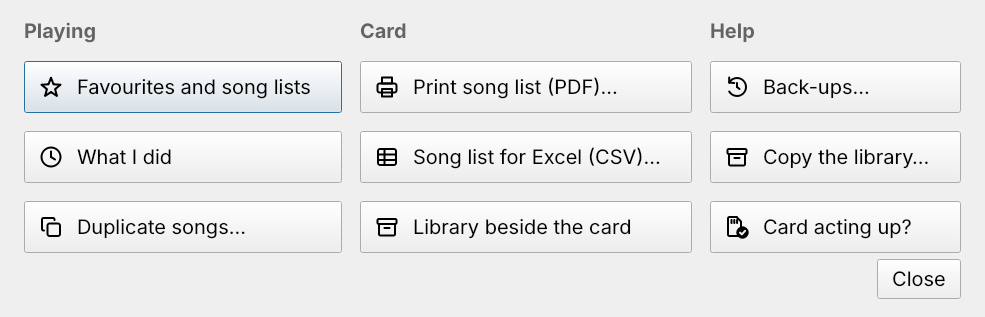

### Favourites and song lists

On the keyboard you can use favourites (buttons 1 to 9, in banks) and three song lists. A favourite or song list
points to a song. The song itself is on the card only once.

You don't have to use them. Copying songs to a folder that you use as a set list works fine too.

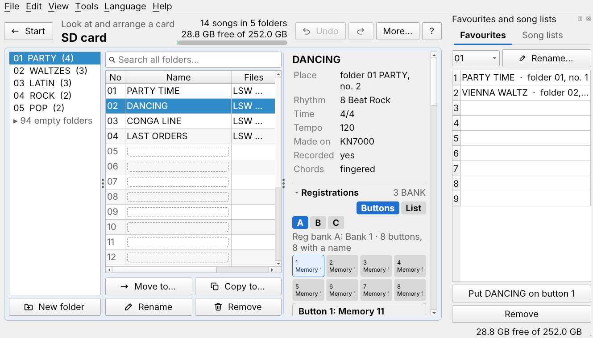

In **More…** click **Favourites and song lists**.

- **Making a favourite**: choose a bank and click a button (1 to 9). Then choose a song and click the button
  below. It says exactly what happens, for example **Put DANSEN on button 3**. With **Remove** you make a button
  empty again.
- **Making a song list**: choose list 1, 2 or 3. Choose a song and click **+ Add chosen song**. Drag a song in
  the list to change the order. With **Remove** you take a song out of the list; the song itself stays on the
  card.

### What is in a song?

Switch on the **Song information** panel (**View › Song information**, or **Cmd+I**) and click a song. On the
right you then see everything that is in it: the rhythm, the time signature, what has been recorded, the buttons
of the Reg Banks, and also own rhythms, pads and own sounds if there are any. See also
[chapter 2](#song-information-on-the-right). Is the panel too narrow? Then drag the edge next to it.

## 9. Something went wrong? Restoring a back-up

Every time you click **Put on card**, the program first makes a back-up on the computer. That way you can always
go back.

1. Click **More…** and then **Back-ups…**.
2. You see the back-ups of all your cards. Those of the card that is open now are at the top.
3. Click a moment, for example "Today 14:32". On the right you see what was on the card then.
4. Choose what you want:
   - **Restore to this card**: the card becomes as it was then. Here too the program makes a back-up first, so
     you lose nothing.
   - **Start a new card from it**: that old content becomes a new card, which you can put on any SD card. Handy
     if the old card is broken or lost.
   - **Put in the library**: the old content goes into the library as a card, so you can take songs from it.

**Restore to this card** opens a window with the steps **Sure? → Restore → Done**. Do not take the card out
until you see **Done**. **Put in the library** and **Make a back-up now** also open a window with steps.

With **Make a back-up now** you make a back-up of the open card straight away. **Show in Finder** shows where the
back-ups are on the computer.

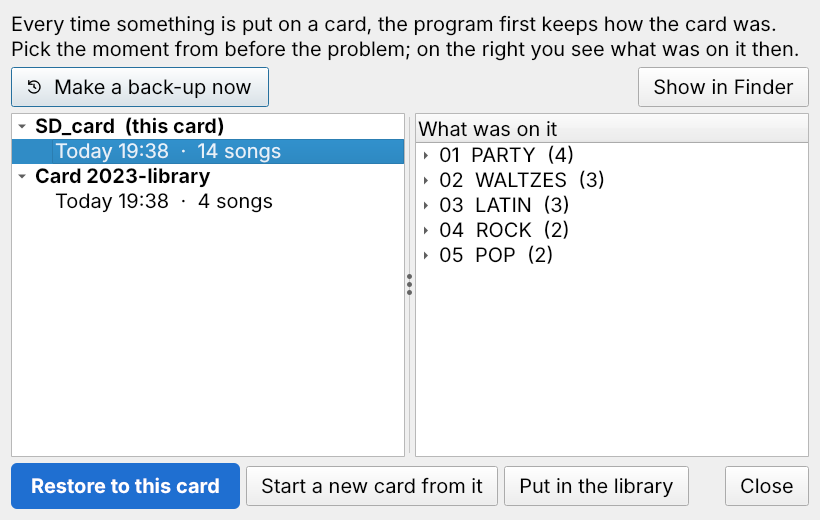

### Is the keyboard acting strangely with the card?

Click **More…** and then **Card acting up?**. A window opens with the steps **Check → Repair → Done**. The program
checks the card. If it finds something, it says what is wrong. Then click **Repair**. The program makes a back-up
first and then puts it right. If everything is fine, you see **Done** straight away.

## 10. Good to know

- **Duplicate songs**: **More… › Duplicate songs…** shows which songs are on the card more than once. That is
  fine, for example if you use folders as set lists. You don't have to clean anything up.
- **Library beside the card**: **More… › Library beside the card** also puts the library next to a card you are
  arranging. Then you can put songs from the library on that card.
- **A second card alongside**: with **File › Second card alongside…** you see a second card, from which you drag
  songs to the open card. You need two card readers for that.
- **Save song list**: **More… › Save song list (PDF or CSV)…** makes an overview of all songs on the card, to print or open in Excel.
  You choose what is on it: folder by folder or all songs by name (A to Z, handy to look a song up quickly), your
  own title, the date and page numbers at the bottom, large print for the music stand, and whether empty folders
  are included, and landscape paper. The program remembers your choice for next time. The columns get the room the paper
  has. With many columns the letters get smaller (down to 8 point), and the app turns the paper on its side by
  itself when that keeps the letters bigger; this also goes for large print. Only if it still does not fit
  are long texts shortened with "…". A column never runs off the edge of the paper. With **Landscape paper**
  the paper is always on its side. With **Songs in diskette sets each on their own line**, every song in such a set gets its own line,
  with the set's name next to it. With a library, you choose
  at the top whether the list is about the open card or the whole library. By name (A to Z) then shows, for each
  song, on which card, in which folder and at which number it is.
  At the top of the window you choose **Save as**: a PDF to print, or a CSV for Excel or Numbers. The CSV is
  exactly the same list, without layout: Folder and Folder name are at the front of every line instead of
  being a heading, and empty columns are left out. The app remembers what you chose last time.
- **A copy of the library**: **More… › Copy the library…** puts your whole library on a USB stick or an external
  drive. Choose the stick and click **Make the copy here**. Every file is checked. If you do it again later, the
  program only copies what is new or changed.
- **Bigger letters**: in the menu bar choose **View › Text size**: Normal, Large or Very large. You see it
  straight away; your card and changes that are not on the card yet stay as they are.
- **Language**: in the menu bar under **Language** you choose Dutch or English.

### Shortcuts

<!-- mac -->
| Key | What it does |
|-----|--------------|
| Cmd+Z | Undo |
| Shift+Cmd+Z | Redo |
| Cmd+S | Put on card |
| Cmd+F | Find |
| Cmd+A | Choose everything in the list you are working in: the folder's songs, the folders or the library |
| F2 | Rename the chosen song |
| Delete or Cmd+Backspace | Remove the chosen song |
| Shift+Cmd+M | Move to… |
| Shift+Cmd+C | Copy to… |
| Shift+Cmd+N | New folder |
| Cmd+I | Song information on or off |
| Shift+Cmd+L | Library beside the card on or off |
| Cmd+[ | Back to the start |
| Cmd+plus / Cmd+minus | Letters bigger or smaller |
| Cmd+? | This manual |
<!-- /mac -->
<!-- win -->
| Key | What it does |
|-----|--------------|
| Ctrl+Z | Undo |
| Ctrl+Y | Redo |
| Ctrl+S | Put on card |
| Ctrl+F | Find |
| Ctrl+A | Choose all songs in the folder |
| F2 | Rename the chosen song |
| Delete | Remove the chosen song |
| Shift+Ctrl+M | Move to… |
| Shift+Ctrl+C | Copy to… |
| Shift+Ctrl+N | New folder |
| Ctrl+I | Song information on or off |
| Shift+Ctrl+L | Library beside the card on or off |
| Alt+left arrow | Back to the start |
| Ctrl+plus / Ctrl+minus | Letters bigger or smaller |
| F1 | This manual |
<!-- /win -->
