# Handleiding KN Songboek

KN Songboek is een programma voor de computer. Je gebruikt het om de songs op de SD-kaart van je Technics KN7000
netjes te zetten. Je kunt songs verplaatsen, kopiëren, een andere naam geven en weghalen. Je kunt je kaarten
en muziekdiskettes bewaren op de computer. En je kunt uit al je songs een nieuwe kaart maken. Daarna werkt de
kaart gewoon weer in het keyboard.

Je hoeft niets van computers te weten. Lees gewoon het stukje over wat je wilt doen.

**Het belangrijkste om te onthouden**

- Op de kaart verandert pas iets als je op **Op kaart zetten** klikt. Tot die tijd kun je rustig proberen.
- Vergist? Klik op **Ongedaan maken**. Dat kan zo vaak als je wilt.
- Voordat het programma iets op een kaart zet, bewaart het eerst een reservekopie (een *back-up*) op de
  computer. Je raakt dus niets kwijt.

*De plaatjes in deze handleiding zijn gemaakt met verzonnen songs.*

<!-- bestand -->
*Deze handleiding is geschreven voor de Mac. Gebruik je Windows? Lees dan **Ctrl** waar **Cmd** staat, **Alt**
waar **Option** staat en **Verkenner** waar **Finder** staat. Bij de sneltoetsen staat een tabel voor allebei.
In het programma zelf (de knop **?**) zie je de handleiding meteen met de toetsen van jouw computer.*
<!-- /bestand -->

## Inhoud

1. [Beginnen](#1-beginnen)
2. [Een kaart bekijken en ordenen](#2-een-kaart-bekijken-en-ordenen)
3. [Werken met songs](#3-werken-met-songs)
4. [Mappen ordenen](#4-mappen-ordenen)
5. [Op kaart zetten en ongedaan maken](#5-op-kaart-zetten-en-ongedaan-maken)
6. [Een kaart of diskette bewaren in de bibliotheek](#6-een-kaart-of-diskette-bewaren-in-de-bibliotheek)
7. [Een nieuwe kaart samenstellen](#7-een-nieuwe-kaart-samenstellen)
8. [Meer…: favorieten, songlijsten en wat er in een song zit](#8-meer-favorieten-songlijsten-en-wat-er-in-een-song-zit)
9. [Iets misgegaan? Een back-up terugzetten](#9-iets-misgegaan-een-back-up-terugzetten)
10. [Goed om te weten](#10-goed-om-te-weten)

**Een paar woorden die vaak terugkomen**

| Woord | Wat het is |
|-------|------------|
| **SD-kaart** (of *kaart*) | Het kleine geheugenkaartje uit het keyboard. Daar staan je songs op. |
| **Map** | Op de kaart staan 99 mappen, en in elke map passen 20 songs. Net als op het keyboard. |
| **Bibliotheek** | Een map op de computer met een kopie van je kaarten en diskettes. Daaruit kies je songs voor een nieuwe kaart. |
| **Back-up** | Een reservekopie die het programma zelf maakt, zodat je altijd terug kunt. |

## 1. Beginnen

Start KN Songboek. Het programma vraagt **Wat wil je doen?** Je ziet drie grote knoppen:

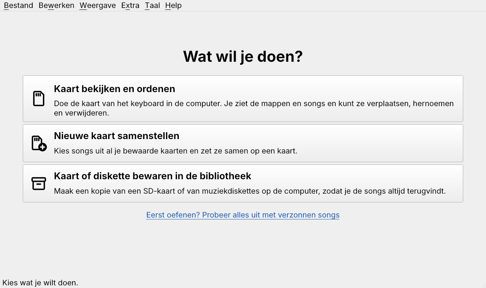

- **Kaart bekijken en ordenen**: kijken wat er op de kaart van het keyboard staat en het netjes zetten.
  Zie [hoofdstuk 2](#2-een-kaart-bekijken-en-ordenen).
- **Nieuwe kaart samenstellen**: songs van al je bewaarde kaarten bij elkaar zetten op één kaart.
  Zie [hoofdstuk 7](#7-een-nieuwe-kaart-samenstellen).
- **Kaart of diskette bewaren in de bibliotheek**: een kopie van een kaart of een muziekdiskette op de computer
  zetten. Dan vind je die songs altijd terug. Zie [hoofdstuk 6](#6-een-kaart-of-diskette-bewaren-in-de-bibliotheek).

Linksboven staat altijd de knop **Begin**. Daarmee kom je terug op dit scherm. Rechtsboven staat een **?**.
Klik daarop als je even niet weet hoe iets werkt: dan zie je het stuk van deze handleiding dat over dat scherm
gaat.

De eerste keer staat er bovenin een blauwe tip. Klik op **Begrepen** om hem weg te halen.

### Eerst oefenen

Wil je eerst rustig proberen hoe alles werkt? Klik onder de drie knoppen op **Eerst oefenen? Probeer alles uit
met verzonnen songs**.

- Je werkt dan met verzonnen songs. Er zit al een oefenkaart in de computer, en in de bibliotheek staat al een
  bewaarde kaart.
- De drie knoppen werken precies zoals in het echt.
- Een kaart in de computer doen gaat met de knop **Kaart wisselen…** in de oranje balk bovenaan. Daar kies je
  de oefenkaart, een nieuwe lege kaart, of geen kaart.
- Je echte kaarten en je echte bibliotheek blijven zoals ze zijn.

Klaar met oefenen? Klik op **Stoppen met oefenen**. De volgende keer begint het oefenen weer helemaal opnieuw.

## 2. Een kaart bekijken en ordenen

1. Haal de SD-kaart uit het keyboard en stop hem in de computer (of in een kaartlezer).
2. Klik op **Kaart bekijken en ordenen**. Het programma zoekt de kaart zelf.

Zitten er twee kaarten in de computer? Dan vraagt het programma welke je bedoelt. Vindt het geen kaart? Dan
zegt het dat. Doe de kaart erin en klik op **Opnieuw zoeken**.

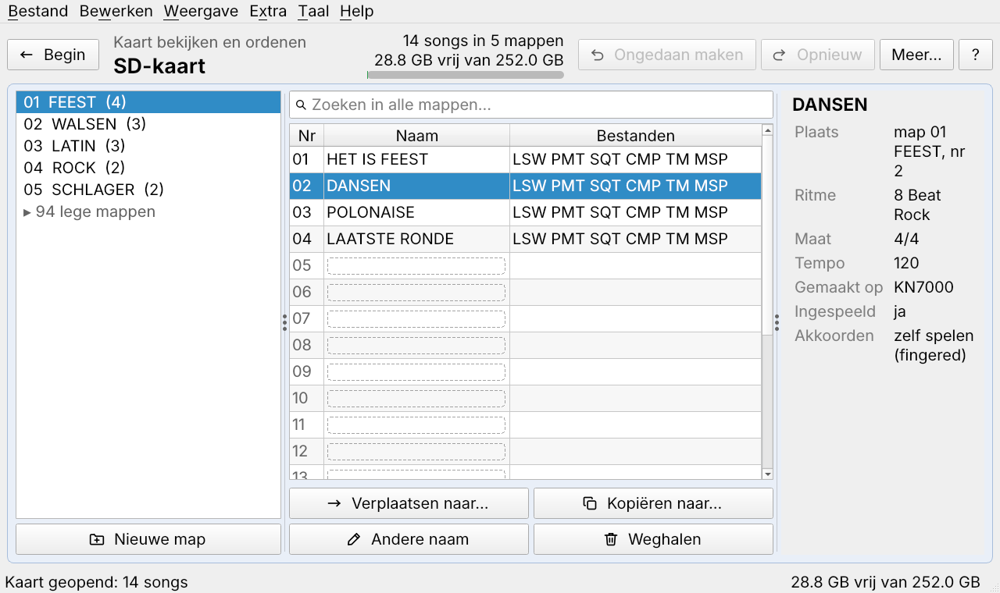

Dit zie je dan:

- **Bovenaan**: de naam van de kaart, hoeveel songs en mappen erop staan, en een balk die laat zien hoe vol
  de kaart is.
- **Links**: de mappen waar songs in staan, met het aantal songs erachter. De lege mappen zitten samen achter
  één regel, bijvoorbeeld "▸ 94 lege mappen". Klik daarop om ze te zien.
- **In het midden**: de 20 plaatsen van de map die je links hebt gekozen, net als op het keyboard. Een lege
  plaats is een licht gestippeld vakje.
- **Boven de songs**: een zoekvak. Typ een stukje van een naam, en je ziet die song in alle mappen.
- **Rechts**: informatie over de song die je hebt aangeklikt, als dat paneel aan staat. Zie hieronder.

### Informatie over de song (rechts)

Rechts kan een paneel staan met informatie over de song die je hebt aangeklikt. Dat paneel zet je zelf aan of
uit: kies in de menubalk **Weergave › Informatie over de song** (of druk op **Cmd+I**). Het programma onthoudt
je keuze. Staat het paneel uit, dan zie je rechts niets, en heb je meer ruimte voor de mappen en songs.

Staat het paneel aan, dan klik je op een song. Bovenaan het paneel staat het belangrijkste: op welke plaats de song staat, het ritme, de maatsoort, het tempo, of er iets
is ingespeeld, en in welke favorieten of songlijsten hij staat.

Daaronder staat alles wat er verder in de song zit, onder kopjes. Klik op een kopje (▾ of ▸) om het open of
dicht te klappen.

Onder **Registraties** zie je de knoppen van het paneel (de Reg Banks). Je kunt kiezen hoe je ze ziet:

- **Knoppen**: kies een bank (A, B of C) en je ziet de 8 knoppen, net als op het keyboard. Klik op een knop
  en je ziet het ritme, het tempo, de akkoorden en de klanken. Een grijze letter is een lege bank.
- **Lijst**: alle banken onder elkaar. Dat is handig om banken met elkaar te vergelijken. Klik op ▸ bij een
  knop om de instellingen te zien.

Wil je alles zien wat het programma uit de song kan lezen? Kies dan in de menubalk **Weergave › Uitgebreide
informatie**. Waarden waarvan nog niet zeker is wat ze betekenen, staan in oranje.

## 3. Werken met songs

Klik op een song om hem te kiezen. Wil je meer songs tegelijk kiezen? Houd dan **Shift** of **Cmd** ingedrukt
terwijl je klikt.

Onder de songs staan vier knoppen:

- **Verplaatsen naar…**: de song gaat naar een andere map. Je kiest de map uit een tabel met per map het
  nummer, de naam, hoeveel songs erin staan en hoeveel plaatsen nog vrij zijn. Volle mappen staan er niet
  in. Onderaan staat **+ Nieuwe map…**.
- **Kopiëren naar…**: de song komt er in een andere map bij. Het origineel blijft staan.
- **Andere naam**: de song een andere naam geven.
- **Weghalen**: de song van de kaart halen.

Dezelfde keuzes krijg je ook als je met de rechtermuisknop op een song klikt.

**Hele mappen weghalen**: kies in de mappenlijst een of meer mappen (Cmd-klik of Shift-klik) en druk op
Delete, of klik met de rechtermuisknop en kies **Map(pen) weghalen…**. Na één vraag gaan de songs eruit en zijn
de mappen weer leeg. Met **Ongedaan maken** krijg je ze terug zolang je nog niet hebt opgeslagen.

Een naam mag 16 tekens lang zijn. Gebruik geen letters met accenten (zoals é of ü), want die kan het keyboard
niet laten zien.

### Liever slepen?

| Wat wil je? | Zo doe je het |
|-------------|---------------|
| Een song kopiëren naar een andere map | Sleep de song naar een map in de lijst links. Je ziet dan een "+". |
| Een song verplaatsen naar een andere map | Sleep de song, en houd tijdens het slepen **Option** ingedrukt. |
| De volgorde in een map veranderen | Sleep de song naar een andere plaats in dezelfde map. De twee songs ruilen van plaats. |
| Een paar songs bij elkaar zetten | Kies de songs en sleep ze naar een plaats in dezelfde map. Ze komen daar achter elkaar te staan; de andere songs schuiven op. |
| Een andere naam geven | Dubbelklik op de naam. |

Tijdens het slepen zie je ook de lege mappen. De map onder de muis licht op, en onderin het scherm staat wat er
gaat gebeuren.

Na elke wijziging staat onderin even een balkje, bijvoorbeeld "1 song verplaatst naar map 3". Daarnaast staat
**Ongedaan maken**, voor als het niet de bedoeling was.

Staat een song ook in een favoriet of een songlijst? Dan gaat die gewoon mee als je de song verplaatst.

## 4. Mappen ordenen

Je kunt een hele map verslepen naar een andere plaats in de lijst.

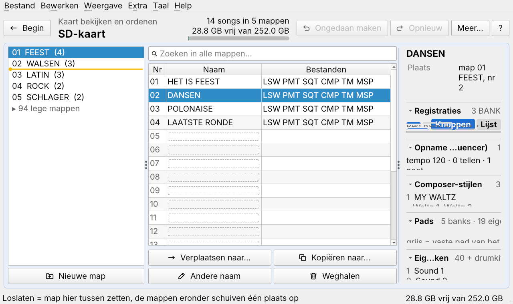

- Sleep je de map **tussen twee andere mappen**, dan zie je een gele lijn. Laat je de muis los, dan komt de
  map daar te staan. De mappen eronder schuiven één plaats op.
- Sleep je de map **op een lege map**, dan zie je een geel kader. De map verhuist naar die plaats, met zijn
  naam en al zijn songs.

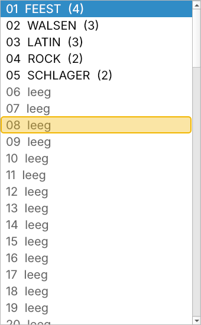

Meer mappen tegelijk verplaatsen? Houd **Cmd** ingedrukt en klik op de mappen die je wilt hebben (of klik op de
eerste en houd **Shift** ingedrukt bij de laatste). Sleep ze dan samen tussen twee andere mappen. Ze komen daar
achter elkaar te staan, in hun eigen volgorde. De andere mappen schuiven op.

Een map een andere naam geven? Dubbelklik op de map.

Een nieuwe map maken? Klik op **Nieuwe map** onder de lijst. De eerste lege map krijgt dan de naam die je
typt.

## 5. Op kaart zetten en ongedaan maken

Alles wat je verandert, staat eerst alleen in het programma. Op de kaart is dan nog niets veranderd. Je ziet
bovenaan een **gele balk** zolang er iets is dat nog niet op de kaart staat.

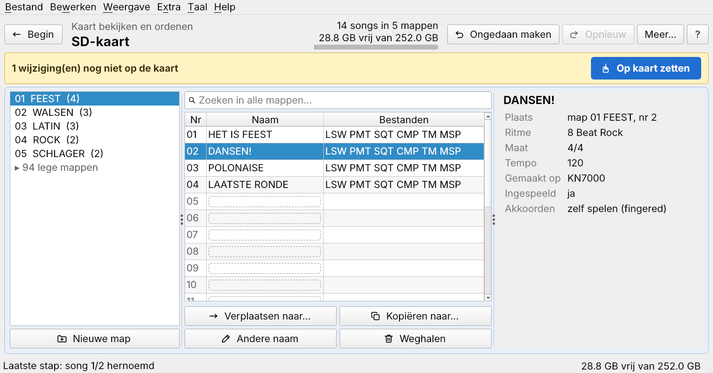

- **Ongedaan maken** (knop bovenaan): de laatste wijziging terugdraaien. Dat kan zo vaak als je wilt.
- **Opnieuw** (knop ernaast): een wijziging die je ongedaan hebt gemaakt, toch weer doen.
- **Op kaart zetten** (knop in de gele balk): alle wijzigingen op de kaart zetten.

### Wat gebeurt er bij Op kaart zetten?

Er gaat een venster open. Bovenin zie je de stappen, met een rondje en een nummer. Het blauwe rondje is de stap
waar je nu bent. Een stap die klaar is, krijgt een groen vinkje. Daaronder staat bijvoorbeeld **Stap 2 van 3**.

Het programma:

1. kijkt of er genoeg ruimte op de kaart is, en of de kaart beschreven mag worden;
2. maakt een back-up van de kaart op de computer;
3. zet de wijzigingen op de kaart;
4. leest alles terug en controleert of het klopt.

Dit lijstje zie je in het venster. Wat klaar is, krijgt een groen vinkje. Waar het programma nu mee bezig is,
staat dikgedrukt. Onder de balk staat **Haal de kaart er nog niet uit.** Haal de kaart er pas uit als je
**Klaar** ziet.

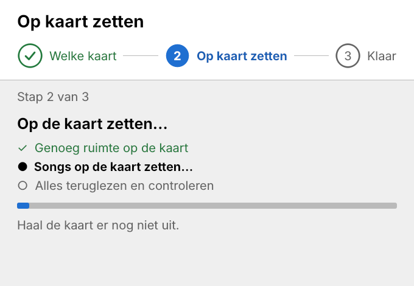

Daarna zie je een groot vinkje en **Klaar**. Het programma werpt de kaart netjes uit. Je kunt hem er nu uit
halen en terug in het keyboard doen.

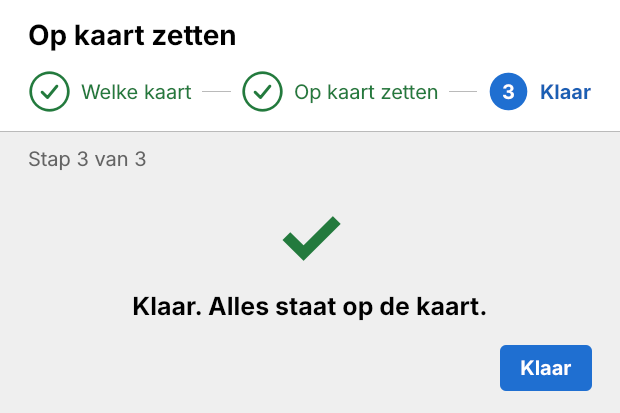

Klik je op **Begin**, of sluit je het programma terwijl er nog wijzigingen zijn? Dan vraagt het programma of
je ze eerst op de kaart wilt zetten, of wilt weggooien.

### Als er iets niet klopt

Gaat er iets mis, dan zegt een melding in gewone woorden wat er gebeurde en wat je kunt doen. Onderaan staan
kleine grijze regels met technische details. Die zijn voor als je iemand om hulp vraagt.

- **Was de kaart de vorige keer te vroeg uit de computer gehaald?** Dan zegt het programma dat als je de kaart
  opent. Je kunt dan alles terugzetten zoals het was.
- **Mist de kaart bestanden van songs?** Dan biedt het programma aan om de lijst met songs op de kaart
  opnieuw op te bouwen.
- **Staan er losse bestanden op de kaart die bij geen enkele song horen?** Dan vraagt het programma wat je
  wilt. Met **Opruimen** worden ze weggehaald bij de volgende keer Op kaart zetten. Met **Laten staan**
  verandert er niets.

## 6. Een kaart of diskette bewaren in de bibliotheek

De bibliotheek is een map op de computer. Daarin staat een kopie van elke kaart en diskette die je bewaart. Je
gebruikt de bibliotheek om songs in op te zoeken en om nieuwe kaarten uit samen te stellen. Je kaarten zelf
veranderen er niet door.

### Een SD-kaart bewaren

1. Stop de kaart in de computer.
2. Klik op **Kaart of diskette bewaren in de bibliotheek**. Er gaat een venster open met bovenin de stappen.
   Zit de kaart er nog niet in? Doe hem er dan in; het programma gaat vanzelf verder.
3. De eerste keer vraagt het programma waar de bibliotheek moet komen. Het stelt zelf een plek voor
   (*Documenten/KN7000 Bibliotheek*). Klik op **Ja, daar**, tenzij je een andere plek wilt. Het programma
   onthoudt dit.
4. Typ wat er op het **etiket** van de kaart staat, bijvoorbeeld "Kaart bruiloften". Zo heet de kaart in de
   bibliotheek, en zo herken je hem straks meteen.

Bewaar je later dezelfde kaart nog een keer? Dan herkent het programma hem. Het vraagt dan of je de oude kopie
op de computer wilt vervangen door wat nu op de kaart staat. Zo blijft de bibliotheek bij. De oude kopie
wordt eerst nog als back-up bewaard.

### Alles wordt gecontroleerd

Bij het bewaren controleert het programma elk bestand drie keer. Aan het eind zie je elke controle met een ✓:

- **Gelezen**: elk bestand is twee keer gelezen, en was beide keren hetzelfde. Zo valt een slechte plek op een
  oude diskette op.
- **Uitgepakt**: elke song is helemaal uitgepakt, zonder fouten.
- **Teruggelezen**: wat in de bibliotheek staat, is teruggelezen en vergeleken met het origineel.

Gaat er iets mis, dan krijg je een melding met de naam van de song. In de bibliotheek staat die song dan in
oranje, met een ⚠ achter de naam. Wil je hem toch op een kaart zetten, dan vraagt het programma eerst of je
het zeker weet.

### Muziekdiskettes bewaren

Diskettes van de KN7000 en de KN6000 bewaar je met dezelfde knop. Je hebt een diskettestation nodig (een
USB-diskettestation werkt prima).

1. Doe de diskette in het diskettestation.
2. Klik op **Kaart of diskette bewaren in de bibliotheek**. Zit er ook een SD-kaart in? Dan vraagt het
   programma welke je bedoelt.
3. Typ wat er op het **etiket** van de diskette staat.
4. Het programma leest de diskette. Dat duurt ongeveer een halve minuut. De diskette zelf verandert niet.
5. De diskette komt eruit, en je ziet **✓ Diskette 1 staat in de bibliotheek**. Doe meteen de volgende
   diskette erin: het programma gaat vanzelf verder. Zo werk je een hele stapel af.
6. Geen diskettes meer? Klik op **Klaar**.

Doe je een diskette die al in de bibliotheek staat? Dan herkent het programma hem en kun je hem overslaan.

In de bibliotheek staan de diskettes samen onder **Diskettes**. Elke set op een diskette is daar één song. Die
kun je net als andere songs op een nieuwe kaart zetten.

### Een download van internet bewaren

Heb je songs gedownload als zip-bestand? Dubbelklik op het zip-bestand om het uit te pakken. Klik dan op
**Kaart of diskette bewaren in de bibliotheek**, daarna op **Zelf een map kiezen…**, en kies de uitgepakte map.
Het programma behandelt die map als een diskette.

Let op: veel downloads zijn voor de KN5000. Die kan het programma niet lezen. Bij **Gemaakt op** staat dan
*KN5000*.

### Een kaart in de bibliotheek hernoemen of weghalen

Ga naar **Nieuwe kaart samenstellen** en kies links bovenaan de kaart. Daaronder staan twee knoppen:

- **Kaart hernoemen…**: de kaart in de bibliotheek een andere naam geven.
- **Kaart weghalen…**: de kaart uit de bibliotheek halen. Hij gaat naar de Prullenbak, dus je kunt hem daar
  nog terughalen. De echte kaart of diskette verandert niet.

## 7. Een nieuwe kaart samenstellen

Klik op **Nieuwe kaart samenstellen**. Heb je al kaarten bewaard? Dan vraagt het programma eerst **Hoe wil je
beginnen?**

- **Leeg beginnen**: je begint met een lege kaart.
- **Beginnen met** een bewaarde kaart: alles van die kaart staat er al op (mappen, songs, songlijsten en
  favorieten). Je past alleen aan wat anders moet.

Het scherm heeft twee kanten:

- **Links, in een groen vlak: de Bibliotheek.** Hier staan alle songs van al je bewaarde kaarten en
  diskettes. Hier kies je songs uit. Aan de bibliotheek zelf verandert niets.
- **Rechts, in een blauw vlak: Je SD-kaart.** Dit is de nieuwe kaart. Wat hier staat, komt op de SD-kaart als je op **Op kaart
  zetten** klikt.

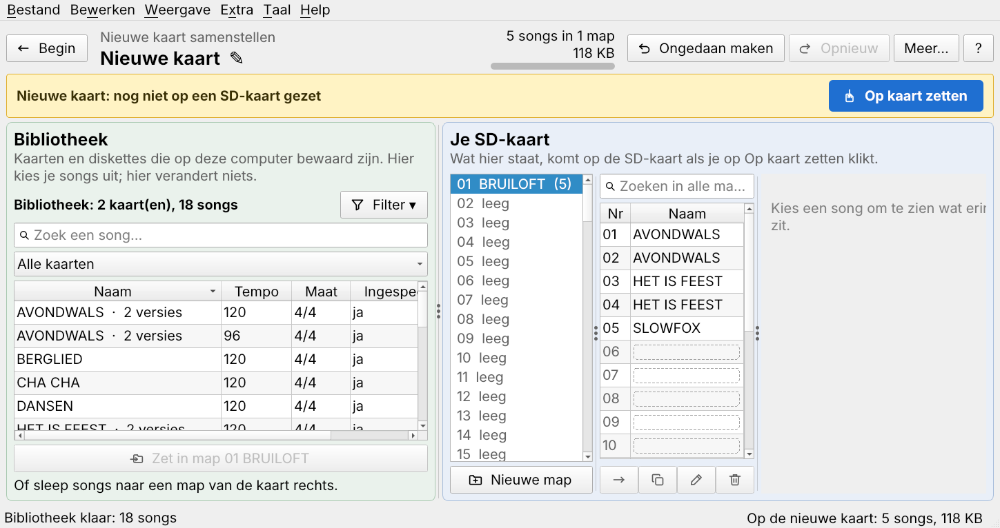

### Songs uit de bibliotheek kiezen

- **Zoeken**: typ een stukje van de naam in het zoekvak.
- **Filter**: klik op **Filter** om meer keuzes te zien. Staat er een filter aan, dan zie je dat op de knop,
  bijvoorbeeld *Filter (2)*.
  - **Nog niet op mijn kaart**: verbergt de songs die al rechts op je nieuwe kaart staan. Ook als je ze daar
    een andere naam hebt gegeven.
  - **Alleen ingespeeld**: alleen songs waarin iets is ingespeeld.
  - **Alleen beschadigd (⚠)**: alleen de oranje songs.
  - **Tempo** en **Maat**: bijvoorbeeld alleen walsen (3/4), of alleen songs tussen 90 en 120.
  - **Alleen van SD-kaarten** of **Alleen van diskettes**.
  - **Maar op één kaart** of **Op meer dan één kaart**: zo zie je welke songs je maar één keer hebt.
- **Op kaart**: deze kolom zegt op welke kaart en in welke map een song staat. Zo kun je ook het echte kaartje
  erbij pakken.
- **"· 2 versies"** achter een naam: er zijn twee songs met dezelfde naam, maar ze zijn niet helemaal
  hetzelfde.

**Een song op je kaart zetten:** klik rechts eerst op de map waar hij in moet. Kies dan links de song en klik
op **Zet in map …**. Dubbelklikken of slepen naar een map rechts kan ook.

### Eén bewaarde kaart bekijken

Kies een kaart in het keuzevak bovenaan de bibliotheek. Je ziet dan de mappen van die kaart, net als op het
keyboard. Klik op een map om de songs te zien, met hun nummer in de map.

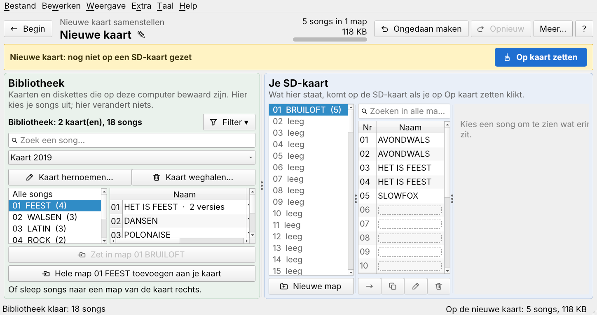

Wil je een hele map in één keer overnemen? Klik op de map en daarna op **Hele map … toevoegen aan je kaart**.
Dat werkt ook voor een songlijst.

Meer mappen tegelijk overnemen? Houd **Cmd** ingedrukt en klik op de mappen. De knop heet dan
**2 hele mappen toevoegen aan je kaart** (of 3, 4 …). Je kunt de mappen ook samen naar de lijst rechts slepen.
Laat je ze los op een lege map, dan beginnen ze daar. Elke map komt in een eigen lege map, met zijn naam en
al zijn songs.

Heb je nog geen kaarten bewaard? Dan staat er links alleen een knop **Kaart of diskette bewaren in de
bibliotheek**.

### Klaar? Op kaart zetten

Klik op **Op kaart zetten**. Er gaat een venster open met de stappen **Welke kaart → Op kaart zetten → Klaar**.

1. Doe een SD-kaart in de computer. Dat kan een lege kaart zijn, of de kaart van het keyboard.
2. Zitten er meer kaarten in? Klik dan op de grote knop van de kaart die je wilt gebruiken.
3. Staan er al songs op die kaart? Dan waarschuwt het programma eerst. Die songs worden vervangen, maar het
   programma bewaart ze eerst in een back-up.

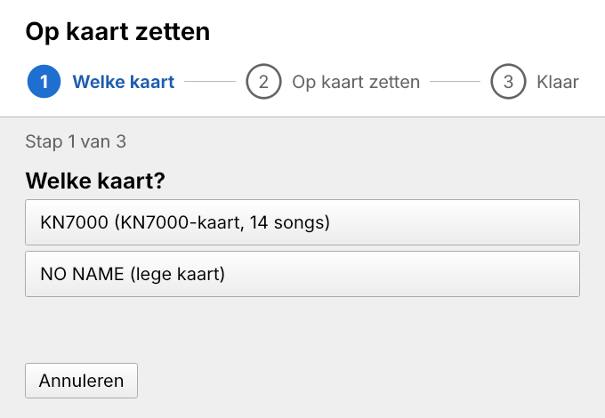

Daarna vraagt het programma of je de nieuwe kaart **ook in de bibliotheek wilt bewaren**. Doe dat als je er
later nog een kaart mee wilt maken. Wil je meteen nog een kaart met dezelfde songs maken? Klik dan op **Nog een
kaart met dezelfde songs**.

### Geen SD-kaart bij de hand?

Je kunt een nieuwe kaart ook eerst alleen op de computer bewaren, en later op een SD-kaart zetten:

1. Klik op **Op kaart zetten**. Het programma zegt dat er geen SD-kaart in de computer zit.
2. Klik op **In de bibliotheek bewaren…** en geef de kaart een naam.
3. Later doe je een SD-kaart in de computer. Klik op **Nieuwe kaart samenstellen**, kies **Beginnen met**
   en de naam van je kaart, en klik op **Op kaart zetten**.

## 8. Meer…: favorieten, songlijsten en wat er in een song zit

Rechtsboven staat de knop **Meer…**. Daar staat wat je niet elke dag nodig hebt, met grote knoppen in drie
groepjes: Spelen, Kaart en Hulp.

Alles staat ook in de menubalk, bovenaan het scherm. Daar staan ook dingen die je bijna nooit nodig hebt, zoals
een kaart met de hand openen, de bibliotheek kiezen en de taal.

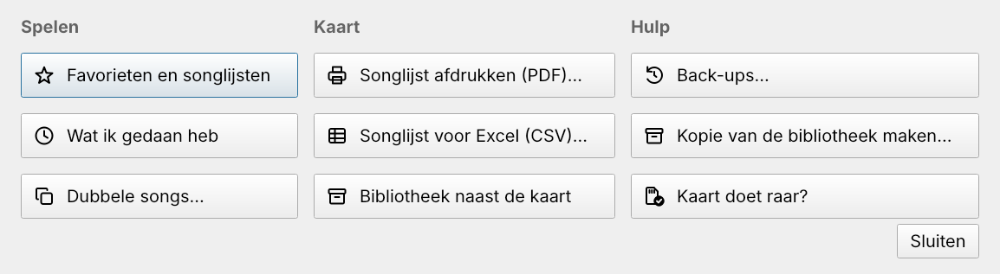

### Favorieten en songlijsten

Op het keyboard kun je favorieten gebruiken (knoppen 1 tot en met 9, in banken) en drie songlijsten. Een
favoriet of songlijst wijst naar een song. De song zelf staat maar één keer op de kaart.

Je hoeft ze niet te gebruiken. Songs kopiëren naar een map die je als setlijst gebruikt, werkt ook prima.

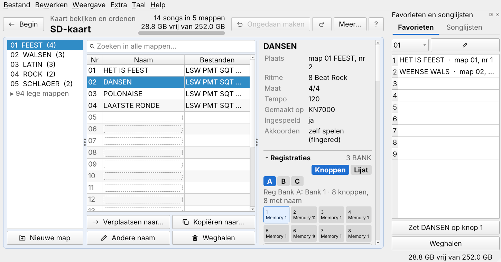

Klik in **Meer…** op **Favorieten en songlijsten**.

- **Een favoriet maken**: kies een bank en klik op een knop (1 tot en met 9). Kies dan een song en klik op de
  knop eronder. Die zegt precies wat er gebeurt, bijvoorbeeld **Zet DANSEN op knop 3**. Met **Weghalen** maak
  je een knop weer leeg.
- **Een songlijst maken**: kies lijst 1, 2 of 3. Kies een song en klik op **+ Gekozen song erbij**. Sleep een
  song in de lijst om de volgorde te veranderen. Met **Weghalen** haal je een song uit de lijst; de song zelf
  blijft op de kaart.

### Wat zit er in een song?

Zet het paneel **Informatie over de song** aan (**Weergave › Informatie over de song**, of **Cmd+I**) en klik
op een song. Rechts zie je dan alles wat erin zit: het ritme, de maatsoort, wat er is ingespeeld, de
knoppen van de Reg Banks, en ook eigen ritmes, pads en eigen klanken als die er zijn. Zie ook
[hoofdstuk 2](#informatie-over-de-song-rechts). Is het paneel te smal? Sleep dan de rand ernaast.

## 9. Iets misgegaan? Een back-up terugzetten

Elke keer dat je op **Op kaart zetten** klikt, maakt het programma eerst een back-up op de computer. Zo kun je
altijd terug.

1. Klik op **Meer…** en dan op **Back-ups…**.
2. Je ziet de back-ups van al je kaarten. Die van de kaart die nu open is, staan bovenaan.
3. Klik op een moment, bijvoorbeeld "Vandaag 14:32". Rechts zie je wat er toen op de kaart stond.
4. Kies wat je wilt:
   - **Terugzetten op deze kaart**: de kaart wordt weer zoals hij toen was. Ook dan maakt het programma eerst
     een back-up, dus je raakt niets kwijt.
   - **Als nieuwe kaart beginnen**: die oude inhoud wordt een nieuwe kaart, die je op elke SD-kaart kunt
     zetten. Handig als de oude kaart kapot of kwijt is.
   - **In de bibliotheek zetten**: de oude inhoud komt als kaart in de bibliotheek, zodat je er songs uit kunt
     halen.

Bij **Terugzetten op deze kaart** gaat er een venster open met de stappen **Zeker weten? → Terugzetten → Klaar**.
Haal de kaart er niet uit tot je **Klaar** ziet. **In de bibliotheek zetten** en **Nu een back-up maken** gaan
ook in zo'n venster met stappen.

Met **Nu een back-up maken** maak je meteen een back-up van de kaart die open is. **Toon in Finder** laat zien
waar de back-ups op de computer staan.

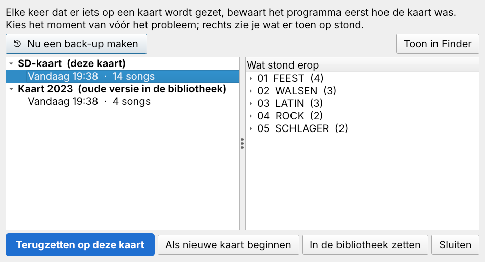

### Doet het keyboard raar met de kaart?

Klik op **Meer…** en dan op **Kaart doet raar?**. Er gaat een venster open met de stappen **Nakijken → Herstellen
→ Klaar**. Het programma controleert de kaart. Vindt het iets, dan zegt het wat er mis is. Klik dan op
**Herstellen**. Het programma maakt eerst een back-up en zet het daarna recht. Is alles in orde, dan zie je
meteen **Klaar**.

## 10. Goed om te weten

- **Dubbele songs**: **Meer… › Dubbele songs…** laat zien welke songs meer dan één keer op de kaart staan. Dat
  is niet erg, bijvoorbeeld als je mappen als setlijst gebruikt. Je hoeft niets op te ruimen.
- **Bibliotheek naast de kaart**: **Meer… › Bibliotheek naast de kaart** zet de bibliotheek ook naast een kaart
  die je ordent. Dan kun je songs uit de bibliotheek op die kaart zetten.
- **Een tweede kaart ernaast**: met **Bestand › Tweede kaart ernaast…** zie je een tweede kaart, waaruit je songs
  naar de open kaart sleept. Daarvoor heb je twee kaartlezers nodig.
- **Songlijst afdrukken**: **Meer… › Songlijst afdrukken (PDF)…** maakt een overzicht van alle songs op de
  kaart, om te printen. Je kiest zelf wat erop komt: map voor map of alle songs op naam (van A tot Z, handig
  om snel een song op te zoeken), een eigen titel, de datum en bladzijdenummers onderaan, grote letters voor
  op de muziekstandaard, liggend papier, en of lege mappen erin moeten. De app onthoudt je keuze voor de
  volgende keer. De kolommen krijgen de ruimte die het papier heeft. Kies je veel kolommen, dan worden de
  letters kleiner, en pas als het dan nog niet past, worden lange teksten ingekort met "…". Met het vinkje
  **Songs in diskette-sets elk op een eigen regel** staat elke song uit zo'n set apart in de lijst, met de naam
  van de set erbij. Heb je een bibliotheek, dan kies je bovenaan of de lijst over de open kaart gaat of over de
  hele bibliotheek. Op naam (A tot Z) zie je dan per song op welke kaart, in welke map en op welk nummer hij staat.
  Bovenaan het venster kies je **Opslaan als**: een PDF om af te drukken, of een CSV voor Excel of Numbers.
  De CSV is precies dezelfde lijst, zonder opmaak: Map en Mapnaam staan vooraan in elke regel in plaats van
  als kop, en lege kolommen blijven weg. **Meer… › Songlijst voor Excel (CSV)…** opent hetzelfde venster, met
  CSV al gekozen.
- **Een kopie van de bibliotheek**: **Meer… › Kopie van de bibliotheek maken…** zet je hele bibliotheek op een
  USB-stick of een externe schijf. Kies de stick en klik op **Kopie hier maken**. Elk bestand wordt
  gecontroleerd. Doe je het later nog eens, dan kopieert het programma alleen wat nieuw of veranderd is.
- **Grotere letters**: kies in de menubalk **Weergave › Lettergrootte**: Normaal, Groot of Heel groot. Je ziet
  het meteen; je kaart en wijzigingen die nog niet op de kaart staan, blijven gewoon staan.
- **Taal**: in de menubalk onder **Taal** kies je Nederlands of Engels.

### Sneltoetsen

<!-- mac -->
| Toets | Wat het doet |
|-------|--------------|
| Cmd+Z | Ongedaan maken |
| Shift+Cmd+Z | Opnieuw |
| Cmd+S | Op kaart zetten |
| Cmd+F | Zoeken |
| Cmd+A | Alles kiezen in de lijst waar je in werkt: de songs van de map, de mappen of de bibliotheek |
| F2 | Andere naam voor de gekozen song |
| Delete of Cmd+Backspace | De gekozen song weghalen |
| Shift+Cmd+M | Verplaatsen naar… |
| Shift+Cmd+C | Kopiëren naar… |
| Shift+Cmd+N | Nieuwe map |
| Cmd+I | Informatie over de song aan of uit |
| Shift+Cmd+L | Bibliotheek naast de kaart aan of uit |
| Cmd+[ | Naar het begin |
| Cmd+plus / Cmd+min | Letters groter of kleiner |
| Cmd+? | Deze handleiding |
<!-- /mac -->
<!-- win -->
| Toets | Wat het doet |
|-------|--------------|
| Ctrl+Z | Ongedaan maken |
| Ctrl+Y | Opnieuw |
| Ctrl+S | Op kaart zetten |
| Ctrl+F | Zoeken |
| Ctrl+A | Alle songs in de map kiezen |
| F2 | Andere naam voor de gekozen song |
| Delete | De gekozen song weghalen |
| Shift+Ctrl+M | Verplaatsen naar… |
| Shift+Ctrl+C | Kopiëren naar… |
| Shift+Ctrl+N | Nieuwe map |
| Ctrl+I | Informatie over de song aan of uit |
| Shift+Ctrl+L | Bibliotheek naast de kaart aan of uit |
| Alt+pijl naar links | Naar het begin |
| Ctrl+plus / Ctrl+min | Letters groter of kleiner |
| F1 | Deze handleiding |
<!-- /win -->
