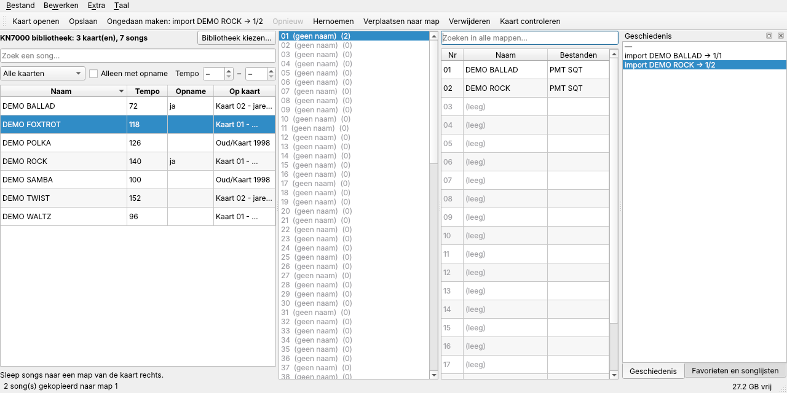

# How-to: al je kaarten in één bibliotheek

De bibliotheek laat alle songs van al je kaarten in één lijst zien. Je kunt erin zoeken, ziet meteen op welke
kaarten een song staat, en stelt een nieuwe kaart samen door songs naar rechts te slepen.

Er is geen database of index: KN Songboek leest bij het openen gewoon alle kaarten in de map. Een kaart erbij zetten
of weghalen is dus genoeg; er hoeft niets bijgewerkt te worden.

## De map inrichten

Maak één map, bijvoorbeeld `KN7000 bibliotheek`, en zet daar elke kaart in een **eigen submap**. De naam van
de submap is de naam waaronder je de kaart in de lijst ziet:

```
KN7000 bibliotheek/
├── Kaart 01 - bruiloften/      (de hele inhoud van een SD-kaart, met de map PRIVATE erin)
├── Kaart 02 - jaren 60/
├── Oude kaarten/
│   ├── Kaart 1998/
│   └── Kaart 1999/
└── Kaart 03/
```

Een kaart kopiëren gaat zoals in [Een SD-kaart veilig kopiëren](kaart-veilig-kopieren.md): kaart op LOCK,
de hele kaart naar een nieuwe submap kopiëren. Submappen mogen tot drie niveaus diep.

De bibliotheek leest alleen; de kaarten in de bibliotheek worden nooit gewijzigd.

## In de app

Bij het starten opent de app de bibliotheek van de vorige keer (Bestand → Bibliotheek kiezen voor een andere).
Links staat de bibliotheek, rechts de kaart waar je aan werkt.



In de terminal:

```
kn-songboek-cli library ls "KN7000 bibliotheek"
kn-songboek-cli library search "KN7000 bibliotheek" wals --tempo 80-110
kn-songboek-cli library copy "KN7000 bibliotheek" /Volumes/KN7000 1 "Kaart 01 - bruiloften:1/2"
```

## Zoeken

Typ een deel van de naam. Filter op kaart, op "alleen ingespeeld" (songs waarin met de sequencer muziek is opgenomen, niet alleen
instellingen) en op tempo. Staat dezelfde song (byte voor byte
gelijk) op meerdere kaarten, dan zie je hem één keer, met "op kaart 3, 7, 12".

Tempo en "ingespeeld" worden uit de songbestanden gelezen; bij een grote bibliotheek vullen die kolommen zich
in een paar seconden na het openen (in de tussentijd staat er "…"). Het tempo is het tempo waarin de song
start: bij een opname het tempo van de opname, anders het tempo dat bij de song is ingesteld.

Snelheid, gemeten met twee kaartkopieën van elk 358 songs: openen 2 seconden, tempo en opnames 1,6 seconden.

## Een nieuwe kaart samenstellen

1. Kies op het startscherm **Nieuwe kaart samenstellen**. De SD-kaart kies je pas bij **Op kaart zetten**; staat
   daar al iets op, dan waarschuwt KN Songboek.
2. Sleep songs uit de bibliotheek naar een map rechts. KN Songboek controleert of er plaats is (20 per map) en of de
   kaart groot genoeg is.
3. Klik op **Opslaan**. Zoals altijd komt er eerst een back-up en kun je tot dan alles ongedaan maken.

## Een hele map of songlijst kopiëren

Veel spelers gebruiken de 99 mappen zelf als setlists. Kies daarom links een kaart: onder de filters verschijnt
een keuzelijst met haar mappen en songlijsten, bijvoorbeeld "Map 03 BRUILOFT (12)" of "Songlijst 1 (8 songs)".
De tabel toont dan precies die songs in hun eigen volgorde. Met **Naar kaart** gaat het geheel naar de kaart rechts:

- **een map** komt in de eerste lege map, met dezelfde naam en de songs op dezelfde plaatsen;
- **een songlijst** komt met al zijn songs, in volgorde, in de eerste lege map (genoemd naar de kaart van
  herkomst), en er wordt een songlijst met dezelfde volgorde gemaakt. Zijn alle 3 songlijsten in gebruik, dan
  vraagt de app welke vervangen moet worden.

Alles wordt gekopieerd, ook songs die al ergens op de kaart staan: dubbele songs zijn geen probleem. Het is één
stap, dus Ongedaan maken haalt het in één keer weg. In de terminal: `kn-songboek-cli library copy-folder` en
`kn-songboek-cli library copy-list` (met `--reuse` worden songs die er al identiek op staan niet opnieuw gekopieerd).

## Diskettes: één set, veel songs

Een diskette staat onder *Diskettes* als een kaart met elke set als song. Een set (bijv. TRAX1) is één pakket
dat je op het keyboard in één keer laadt: 3 algemene banks en daarna per bank 2 songs met elk 4 registraties.
De bibliotheek leest die registratienamen en laat zien voor welke songs de set is:

- in de lijst staat *TRAX1 · set met 20 songs*; houd de muis erop voor de namen;
- zoeken op een songnaam (bijv. *annie*) vindt de set: *TRAX1 · met Annie's Song*;
- in het infopaneel staat bij *Songs erin* welke songs de set heeft, en bij *Akkoorden* of je het akkoord
  zelf speelt (fingered, zoals TRAX1) of met één vinger (one finger, zoals 1FINGR).

Op het keyboard: laad de set, kies met BANK VIEW de bank en dan registratie 1 tot 4 van de song.


- Maatsoort: staat niet als getal in een song, maar volgt uit het ritme. Komt als de ritmetabel bekend is.
