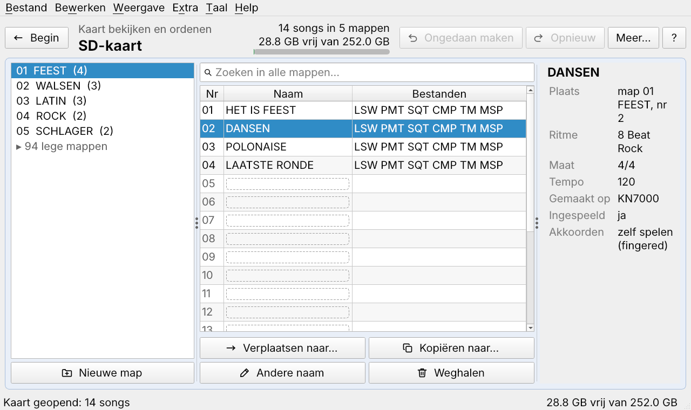
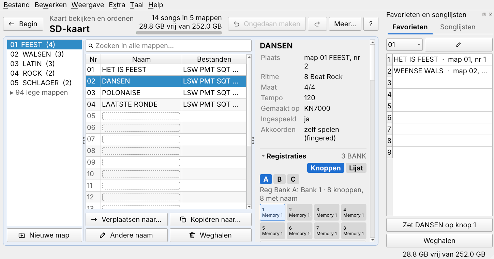

# How-to: werken met de grafische versie

Starten: `kn-songboek` (of `uv run kn-songboek`), eventueel met de kaart erachter: `kn-songboek KAART`.

Het programma begint met de vraag **Wat wil je doen?** en drie taken (ADR-0008): *Kaart bekijken en ordenen*
(zoekt zelf de KN7000-kaart in de computer), *Nieuwe kaart samenstellen* (bibliotheek links, nieuwe kaart
rechts) en *Kaart bewaren in de bibliotheek*. Bovenaan staan **← Begin**, **Ongedaan maken** en **Meer…**;
zolang er iets veranderd is staat er een gele balk met **Op kaart zetten**. Alles hieronder blijft bereikbaar
via **Meer…** of de menubalk.

| Wat | Hoe |
|-----|-----|
| Bibliotheek | bij *Nieuwe kaart samenstellen* links in het venster (bij ordenen via Meer… → Bibliotheek naast de kaart): al je kaarten in één lijst, zoeken en filteren; sleep songs naar een map rechts. Zie [bibliotheek](bibliotheek.md) |
| Kaart openen | Bestand → Kaart openen (Ctrl/Cmd+O) en kies de hoofdmap van de kaart of de kopie |
| Map kiezen | klik links op een map; lege mappen zijn grijs |
| Song hernoemen | dubbelklik op de naam, of F2; max. 16 tekens, alleen gewone letters, cijfers en leestekens |
| Map hernoemen | dubbelklik op de map, of Shift+F2 |
| Volgorde wijzigen | sleep een song op een andere plaats in dezelfde map: een lege plaats krijgt de song, een bezette plaats ruilt |
| Naar een andere map | sleep songs naar een map links: gewoon slepen = kopiëren (de cursor toont een "+"), met Option (Mac) of Alt/Ctrl ingedrukt = verplaatsen; of Ctrl+M |
| Meerdere songs | Shift- of Ctrl/Cmd-klik, daarna slepen, verplaatsen of verwijderen |
| Hele map verplaatsen | sleep een map in de mappenlijst, net als een nummer in een afspeellijst. Een gele lijn tussen twee mappen: loslaten zet de map daar en de mappen ertussen schuiven één plaats op. Een geel kader op een lege map: de map verhuist daarheen |
| Inhoud van een song | klik op een song: het paneel rechts laat alles zien (opname, Reg Banks met elke knop, composer-stijlen, pads, eigen klanken en de homepage-afbeelding) |
| Zoeken | typ in het zoekveld; de resultaten komen uit alle mappen |
| Ongedaan maken | Ctrl/Cmd+Z of de knop bovenaan, opnieuw met Ctrl/Cmd+Shift+Z; of Meer… → Wat ik gedaan heb, en klik op een eerdere stap |
| Op kaart zetten | de knop in de gele balk, of Ctrl/Cmd+S. Eerst controle (schrijfbeveiliging, ruimte), dan een back-up, dan schrijven; daarna "Klaar" (op de Mac wordt de kaart ook uitgeworpen). Bij een nieuwe kaart kies je eerst welke SD-kaart; staan daar al songs op, dan waarschuwt het programma |
| Kaart bewaren | taak 3 op het startscherm: de kaart gaat als map met de naam van het etiket in de bibliotheek; zit hij er al in, dan vraagt het programma of de kopie op de computer vervangen moet worden door wat nu op de kaart staat (de SD-kaart zelf verandert niet) |
| Back-up terugzetten | Extra → Back-up terugzetten… |
| Songlijst | Bestand → Songlijst opslaan (PDF of CSV)… |
| Controleren / herstellen | Extra → Kaart doet raar? (Ctrl/Cmd+K): controleert en biedt herstellen aan |
| Favorieten | Weergave → Favorieten en songlijsten (Ctrl/Cmd+L). Kies een bank, sleep songs op een knop (1-9); Del wist een knop |
| Songlijsten | zelfde paneel, tab Songlijsten: sleep songs erin, sleep binnen de lijst om te ordenen, Del haalt eruit |
| Dubbele songs | Extra → Dubbele songs… Kies per groep de kopie die je houdt; de rest gaat weg en favorieten en songlijsten wijzen daarna naar die song. Kan ook meteen in een songlijst |
| Tweede kaart | Bestand → Tweede kaart ernaast…; sleep songs uit dat paneel naar een map of een lege plaats links |
| Taal | Taal → Nederlands / English (wordt onthouden) |

Niets verandert op de kaart tot je op **Op kaart zetten** klikt. Terug naar het begin of afsluiten met
wijzigingen die nog niet op de kaart staan: het programma vraagt eerst wat je wilt.
